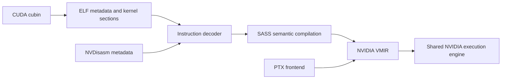

# SASS execution

SASS is a separate ISA frontend. Production code depends on `core` and `isa/nvidia`, with no PTX frontend
dependency; tests use PTX only to validate the checked-in and fixture-recipe PTX modules.



`Cubin` reads CUDA ELF sections, kernel parameters, symbols and constant-bank aliases.
`CodeWords` extracts the architecture's instruction and control words; `FieldDecoder` and
`InstructionDecoder` interpret the encoding, vocabulary and legality data in `NVDisasm`. The decoded
instruction carries a generated `Instruction` case containing typed registers, predicates, constants, addresses
and modifiers. The same cases are used by text parsing and handwritten semantic dispatch. Binary decoding
constructs these operands directly from the generated FORMAT description. Assembly text uses a handwritten recursive-descent parser, sharing core's `text` cursor and numeric parsing
utilities with PTX, to produce the same representation. Runtime decoding uses checked-in metadata and requires no NVIDIA tools.

`NVDisasm.Database` contains the instruction `Form` records and lookup tables recovered from a SASS description,
identified by the description's SHA-256 `digest`; targets with the same description share one database. A `Target`
names an architecture with recovered tables. Architecture-suffixed variants (`SM90a`, `SM100f`) share their base
target's description and are not separate targets. `Generation` (Kepler, Maxwell, Modern) gives the instruction word
and bundle layout.

Binary decoding and its metadata live directly in `sass`. The `asm` package owns parsing, printing, assembly and
disassembly through its four public codecs. Runtime compilation and execution work with `asm` absent.

The closed `Instruction` enum has named operand fields for each logical shape, such as
`MovRegReg(dst, srcB, mods, pred)` and `MovRegConst(dst, sb, mods, pred)`. Operand refinements
validate the underlying kind while retaining unary flags, selectors and exact immediate payloads.
Omitted defaults have distinct arities; the target encoding tables still enforce field widths and legality.
Per-mnemonic union aliases let handwritten semantics handle a family of forms without another opcode enum.

Instruction modifiers are generated tokens, kept in order with repeated tokens intact. Handwritten semantics
interpret them into the shared VM's comparison, rounding and arithmetic types. Register banks, operand
selectors, address modes, floating formats and special registers have separate typed domains. Unknown
vendor spellings can be retained for decoding and printing but have no implicit execution semantics.
Control-flow and predicate-lifetime analysis dispatch on the generated instruction types.

Each case points to a shared `Instruction.Definition`. Definitions expose the mnemonic and the names of the
encoding forms that produce it; `Definition.forMnemonic` works before any instruction exists. Generated
definition files, with up to 256 definitions each, hold the checked constructors; companion accessors expose them
from `Instruction`. Encoding expressions and lookup tables stay in the shared JSON resource rather than being
copied into Scala initialisers. Scheduling-pipe opcode aliases (`IADD3int_pipe`) repeat the plain opcode's value and
are not generated.

Resource loading resolves condition operators and FORMAT field categories once; each form's binding analysis is
computed on first use, so a decoded cubin pays only for the forms it contains. Candidate failure categories are
separate from diagnostic messages, so message wording does not select a decoding result.

`Printer` renders the same typed instructions produced by binary decoding and text parsing.
Decoded instructions retain their selected form, raw field values and resolved bindings so the
encoder can preserve scheduling and non-unique machine encodings.

`VMCompiler` lowers whole functions: legacy control-stack tokens, call and return targets, and the guard around
each instruction. Each instruction is lowered by one of the floating, integer, predicate, tensor, memory and control
families. Each family's `lower` matches the generated cases it owns, reports whether it lowered the instruction,
and uses `VMCompilationContext` and its emission helpers to construct NVIDIA VMIR directly with symbolic branches. `LegacyAddressRewrite` and `LegacyRangeReduction`
recognise verified CUDA 11.8 sm_50/sm_60 idioms before lowering. Scalar and vector memory operations share
four VMIR nodes carrying a typed memory access; both frontends use `VMKernelLaunch` for argument
validation, pointer relocation and interpreter invocation. Condition flags and three-input carry are explicit per-lane machine
state, so consumers follow executed control flow and predication rather than static instruction pairing. `VMAssembler` resolves branch labels into program counters.
No PTX source is emitted or parsed. `LoadedProgram` is the loaded cubin: it compiles kernels lazily, binds
globals and constant banks, and invokes the shared execution engine. `CubinBackend` loads it from an image.

`isa/nvidia` owns the execution IR, lane and warp state, convergence tokens, memory operations and
numerical semantics used by both SASS and PTX. Architecture-specific decoding and ABI handling stay
in their respective frontends.

PTX uses the same boundary: its pinned specification generates modifier tokens and typed modifier
groups. Parsing preserves modifier order and duplicates; handwritten scalar, memory and tensor
compilers interpret those tokens into NVIDIA VMIR. Register parts and operand selectors have their
own domains. Text remains appropriate for user-defined register names, labels and external symbols.

Immutable indexed collections use `collection.Vec`, including decoded operands, catalogue rows and
compiler inputs. Catalogue reconstruction uses local mutable buffers and freezes the result once,
so switching the collection representation does not turn loading into repeated array copies.

Decoded instruction addresses are nonnegative. Register and predicate indices, floating immediate
widths and address scales carry numeric constraints in the operand model. Decoding validates runtime
values before constructing these operands; architecture-specific restrictions remain in the compiler.
The shared tensor model carries positive dimensions and constrained element widths.

The generated resource `decoders.json` holds the target table and decoder data as plain JSON. Typed rows share
strings, encoding expressions, FORMAT trees, conditions, forms and lookup tables across architectures. The runtime
reads these records directly and resolves their indices.
The original recovered NVIDIA descriptions remain in the code generation reference cache, outside
packaged runtime resources.

SASS description extraction lives in `tools/codegen`. `ExtractSASS` runs the capture hooks against the
pinned NVIDIA `nvdisasm` releases, and `GenerateSASSISA` consumes the recovered descriptions to generate
the typed SASS catalogue. Regenerate with:

```sh
sbt 'sass/generateSASSSources'
```

The build fetches and verifies the pinned CUDA 11.8 and 13.3 packages and executable hashes in
[`build.sbt`](../../build.sbt). The capture hooks and
[`expected-sha256.json`](../../tools/codegen/src/main/resources/net/kurobako/gemstone/codegen/sass/expected-sha256.json)
are codegen resources; the latter pins every extracted table. Extraction checks the executable and table
pins, captures each target twice, and writes deterministic, content-addressed gzip tables and a manifest.
Updating pins requires reviewing package provenance and the generated table changes. Cached reference
bundles are verified by digest before reuse. The generator also participates in `codegen` and `checkGeneratedSources`.

Extraction requires Linux x86_64, `gcc`, and the pinned `nvdisasm` executables. The hooks depend on those
specific executable layouts and glibc interfaces. Capture parsing and LZ4 decompression run in Scala;
neither Python nor `liblz4` is required. Temporary capture files are removed after extraction. Original
table descriptions stay in the reference cache for provenance; packaged runtime JSON contains the decoding
metadata and lookup tables.

Capture and extraction regression tests run without CUDA hardware:

```sh
sbt 'codegen/testOnly *SASSCaptureSuite *ExtractSASSSuite'
```

ISA unit suites live under `isa/sass/src/test`: compiler, decoder, and execution tests use Scala cubin
metadata with captured listings or independent machine-word fixtures. Suites are grouped by instruction family;
`Harness` lowers listings or instruction text and runs them on the NVIDIA interpreter, and `Listing` parses
normalised `nvdisasm` listings into instructions and their machine words. Fixtures are Scala objects in the
`fixtures` package, one per suite family, holding producer sources and listings behind `fixtures.Fixture`.
Expected encodings and results remain independent of Gemstone's assembler. `CubinBackend` lifecycle and binding
tests, including one small embedded ELF end-to-end case, live with these suites. Ordinary Scala tests need no CUDA
toolkit, `nvdisasm`, GPU, or checked-in cubin files. Hardware execution and broader frontend comparison belong to conformance, not unit tests.
The `cuda-ptx` and `cuda-sass` conformance routes exercise compiled programs through their respective
frontends. Decoder availability does not imply complete instruction execution coverage; unsupported
operations and operand forms fail explicitly.

`Parser` and `Printer` share this instruction model with `Disassembler` and `Assembler`. The encoder
evaluates the recovered encoding expressions in the forward direction and checks bit widths, overlapping
assignments and operand legality. Machine encoding layouts remain target-specific data; the generated
instruction cases are shared across architectures.

Lossless assembly includes an explicit encoding annotation for form selection, scheduling fields,
non-unique encoding choices and residual bits. The assembler recomputes the fields and verifies that
the result describes the printed instruction. Editing the displayed instruction while retaining an
inconsistent annotation is an error. Plain assembly without an annotation selects a legal encoding
from the target tables and fails explicitly when no unique supported encoding exists.

`asm.Disassembler` and `asm.Assembler` round-trip whole code sections through `asm.Program`, including
instruction fields, legacy bundle control words and the Maxwell/Pascal reserved control bit. `CodeWords.split`/`join` expose
the physical layout separately. These APIs do not construct a CUDA ELF container.

Substantial fixtures keep their producer source, and `fixtures.Recipes` records how each was produced: tool
version, target, commands and any patching steps. Setting `GEMSTONE_VERIFY_FIXTURES=1` reproduces the recipes with
the pinned NVIDIA tools and compares the results; ordinary tests use the stored values without NVIDIA tools. Small
instruction snippets need no recipe. Keep whole kernels where control flow, physical registers or ABI setup matter.
